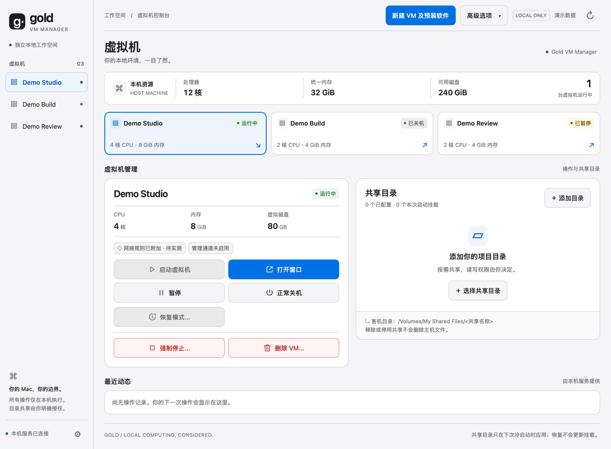

# Gold VM Manager

Run Claude Code in a dedicated macOS VM on an Apple Silicon Mac. First setup uses ordinary networking. After setup, Protected Start restricts outbound traffic to the configured proxy endpoints rather than falling back to a direct connection.

**[Download v1.4.0 source](https://github.com/wbw20000/gold-vm-manager/releases/tag/v1.4.0) · [Watch the 23-second install guide](docs/media/guest-install.gif?raw=true) · [Where is my configuration stored?](#where-is-my-configuration-stored) · [简体中文](README.md)**

> **My experience (last personally confirmed: 2026-11-21):** I use this VM for Claude Code. I used Pro for four days without a ban, then upgraded to Max. On my second day of Max, my account was still active. [Why I built this ↗](https://x.com/clarkwang258/status/2123747367639994757)
>
> **Calendar day since my Max upgrade: <!-- max-days:start -->4<!-- max-days:end -->.** This counter follows the Singapore calendar. It does not sign in to Claude or verify my account status; the dated note above is my personal observation.

*Actual interface with demo data. Click to enlarge.*

## Install the manager (host Mac)

1. **Check first:** Apple Silicon, macOS **26.6.2** (validated version), Apple Command Line Tools or Xcode, system Python 3.9+, and system Ruby with Psych. The default 50 GiB guest disk needs at least **82 GiB** free on the host. Leave additional room for the restore image and cache.
2. On the [v1.4.0 release page](https://github.com/wbw20000/gold-vm-manager/releases/tag/v1.4.0), download **Source code (zip)** and extract it. Double-click [Install.command](Install.command) or run `./Install.command` from the source directory. Open **Gold VM 管理器** in `~/Applications`.
3. This is a **locally ad-hoc signed source build**, not a notarized app download. It neither overwrites an existing app nor starts a VM. Leave Gatekeeper enabled. See [build options](SOURCE_INSTALL.md) for a side-by-side installation.

## Where is my configuration stored?

- **Try it without credentials first.** Choose **新建 VM 及预装软件** (Create VM and Prepare Apps), enter a new name, and select the reviewed restore image. **先不配置 VPN** (Configure VPN Later) lets you restore the system and prepare apps before supplying a node for publication. [View the creation dialog](docs/media/manager-create.png?raw=true).
- **When ready**, save a copy of the [blank Clash YAML template](examples/vpn/clash.yaml) outside the repo, fill it in, and select its local path. Click **校验并私有保存节点 → 同意并开始预装** (Validate and Save Privately → Confirm and Start). The manager does not upload the YAML to GitHub. Node credentials are stored **in plaintext** in a private host directory and shared read-only with the guest during setup. **Read-only is not encryption.** Do not distribute the filled file or VM disk.

## First run: what to do next

| What you see | Next step |
| --- | --- |
| **未启动 · 待首次设置** (Stopped · First Setup Pending) | Choose **首次设置启动…** (Start First Setup) and confirm **ordinary, unfiltered networking** for this boot. Complete macOS setup and enter the guest desktop. |
| **Finder → My Shared Files → gold-installers** | Read **先读我.txt** (Read Me First). Drag each of the four apps **to the guest Desktop, then from the Desktop to Applications**. Do not run them from the share. |
| **Four apps in Applications** | Open Clash Verge. Import the shared file via **Subscriptions → New → Local**, select that profile, then enable TUN. Approve the service prompt **inside the guest**; the host does not need that approval to create the VM. |
| **Clash shows connections using your node** | Shut down normally → **标记首次设置完成…** (Mark First Setup Complete) → **受保护启动…** (Protected Start). The marker is irreversible. Subsequent boots omit the installer share. A webpage loading alone is not proof the proxy works. |

*[Enlarge looping animation](docs/media/guest-install.gif?raw=true) · [Static steps](docs/media/guest-install.png?raw=true). Illustrated guide, not a guest recording.*

The installer share contains **Claude Desktop**. For **Claude Code**, install and sign in separately inside the guest using the [official guide](https://code.claude.com/docs/en/quickstart).

[Troubleshooting: disk space, setup spinner, or Clash running from a temporary path](docs/first-run-troubleshooting.md#english) · [Full guide (Chinese)](ONE_CLICK_PREINSTALL.md) · [Security](SECURITY.md)
