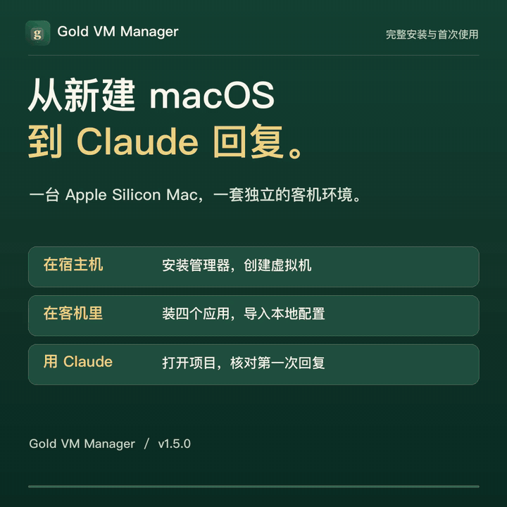
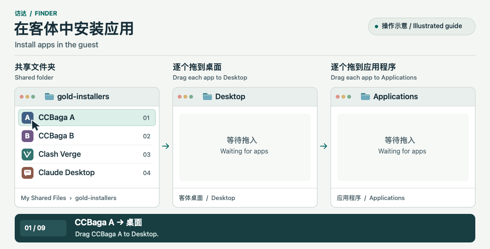

# Gold VM Manager

**[Join the Gold VM WeChat group](https://weixin.qq.com/g/AQYAAMoC6cPVM_wJbKwTY4TAaGCjDxIoHfW81qVt9QjcPD3nTesOm66syMumSJMb)** · Scan with WeChat, or long-press the code in WeChat on mobile. Group invitations expire.

<a href="docs/media/wechat-group.png?raw=true"></a>

Run Claude Code in a dedicated macOS VM on an Apple Silicon Mac. First setup uses ordinary networking. After setup, Protected Start restricts outbound traffic to the configured proxy endpoints rather than falling back to a direct connection.

**[Download v1.5.3 source](https://github.com/wbw20000/gold-vm-manager/releases/tag/v1.5.3) · [Watch the full walkthrough](docs/media/full-walkthrough.gif?raw=true) · [Download and fill in the YAML](#download-and-fill-in-the-yaml-host-mac) · [After installing the four apps](#after-installing-the-four-apps-guest) · [简体中文](README.md)**

> **My experience (last personally confirmed: 2026-11-21):** I use this VM for Claude Code. I used Pro for four days without a ban, then upgraded to Max. On my second day of Max, my account was still active. [Why I built this ↗](https://x.com/clarkwang258/status/2123747367639994757)
>
> **Calendar day since my Max upgrade: <!-- max-days:start -->6<!-- max-days:end -->.** This counter follows the Singapore calendar. It does not sign in to Claude or verify my account status; the dated note above is my personal observation.

[](docs/media/full-walkthrough.gif?raw=true)
*Illustrated walkthrough of v1.5.0 (1 min 58 s, in Chinese). The screens use demo data and show an example Claude response.*

**Already installed and have your YAML?** Start at [Create your first VM](#create-your-first-vm-host-mac), then [install the apps inside it](#first-run-what-to-do-next). Already have a VM? Jump to [daily controls](#daily-controls-host-mac), [shared folders](#share-a-host-folder) or [rebuild and deletion](#rebuild-or-delete-a-vm).

## Install the manager (host Mac)

1. **Check first:** Apple Silicon, macOS **26.6.2** (validated version), Apple Command Line Tools or Xcode, system Python 3.9+, and system Ruby with Psych. Version 1.5.1 accepts whole-number disk sizes from **30 to 1024 GiB**, default 50. For a 30 GiB guest on a single host volume, allow **42 GiB** free when reusing the reviewed IPSW cache, or **62 GiB** for a new download or local import. Small disks leave less room for apps and updates. The previous 1.5.0 release has a 50 GiB minimum and an 82 GiB preflight.
2. On the [v1.5.3 release page](https://github.com/wbw20000/gold-vm-manager/releases/tag/v1.5.3), download **Source code (zip)** and extract it. Double-click [Install.command](Install.command) or run `./Install.command` from the source directory. Open **Gold VM 管理器** in `~/Applications`.
3. This is a **locally ad-hoc signed source build**, not a notarized app download. It neither overwrites an existing app nor starts a VM. Leave Gatekeeper enabled. See [build options](SOURCE_INSTALL.md) for a side-by-side installation.

## Download and fill in the YAML (host Mac)

1. **Download.** In **新建 VM 及预装软件** (Create VM and Prepare Apps), click **下载 YAML 填写模板**. Alternatively, open the [template on GitHub](examples/vpn/clash.yaml) and click **Download raw file** at the top right. If the [raw YAML](https://raw.githubusercontent.com/wbw20000/gold-vm-manager/v1.5.3/examples/vpn/clash.yaml) opens as text in your browser, press `⌘S`. Save it **outside the repository** as `clash.local.yaml`, not `.yaml.txt`.
2. **Choose a protocol.** Open the file in a plain-text editor. Change `proxies: []` to `proxies:`. Find the block matching your node's protocol and remove the leading `# ` from its configuration lines, keeping the indentation. Leave the other blocks commented. Do not paste a subscription URL into `server`.
3. **Fill in your provider's values.** For Trojan TLS/TCP, `server` is your node's public address, `port` is its numeric port, `password` is the node password, and `sni` is the provider's TLS hostname. This example shows the structure only; its values cannot connect. For VLESS, TUIC or another protocol, use that protocol's fields instead.

   ```yaml
   proxies:
     - type: trojan
       server: 192.0.2.10
       port: 443
       password: "REPLACE_WITH_TROJAN_PASSWORD"
       sni: vpn.example.com
       network: tcp
       skip-cert-verify: false
   ```

4. **Copy the path.** Save the file. Select it in Finder on your Mac and press `⌥⌘C` to copy the absolute path for the next screen. Keep the filled YAML private: node credentials are stored in plaintext in private host files, in the read-only installer folder and, once imported, in the guest. Read-only is not encryption. Do not post the YAML, credentials or VM disk.

## Create your first VM (host Mac)

**New in 1.5 — creating another VM:** When an eligible v3 VM exists, check its name under **节点来源** (the first listed VM is selected by default). Click **沿用并校验这组节点** to validate its saved build-time nodes, then confirm creation. This does not clone or modify the source VM. Choose **填写新的节点** for a different YAML or manual input. The same choices are available when resuming a deferred setup.

**Cached restore image?** Keep the default reviewed image to reuse it. The dialog checks receipt metadata for its hint; the build still hashes the whole IPSW. Selecting a local IPSW again imports another copy of about 20 GB.

**Host** means your physical Mac, where **Gold VM 管理器** runs. **Guest** means the new macOS inside the VM window. Start on the **host**; you won't need the guest until the manager says the VM is ready for first setup.

1. Open **Gold VM 管理器**. Check the bottom left for **本机服务已连接** (local service connected). In the top right, click **新建 VM 及预装软件** (create a VM and prepare its apps), **not** “高级选项 → 仅安装 VM” (staging disk only). [View the YAML creation form](docs/media/manager-yaml-form.png?raw=true).
2. Under **1 · 全新系统与资源**, enter a name you haven't used in **新的 VM 名称**. Leave CPU, memory and disk at **2 vCPU / 4 GiB / 50 GiB** for the default configuration. Leave **系统镜像来源** on **经审核的固定 Apple 恢复镜像** to let the host fetch or reuse the reviewed Apple restore image (IPSW).
3. Under **2 · Clash / Mihomo 配置**, leave **先不配置 VPN** unchecked and **手工填写** collapsed. Paste the path of your filled file into **本地 Clash YAML 绝对路径**. If a node's `server` is a hostname, expand **节点使用域名时的设置** and allow the host to resolve it and pin the validated public IPv4 address. A literal public IPv4 needs no DNS permission.
4. Click **校验并私有保存节点** (validate and save privately). Look for **已私有保存** with the number of nodes and endpoints. Read the listed changes: the manager may replace routing, DNS, TUN or proxy-group settings with its own. This screen has **not** connected to the node. Click **同意并开始预装** once to accept the listed changes and start creating the new VM. Nothing is overwritten or booted by this click.
5. Watch the task card above the VM cards. The host obtains and checks the materials, restores macOS and prepares a read-only folder. At **未启动 · 待首次设置** (not started; first setup pending), click **选择新 VM** or click its name in the sidebar. The four apps are ready to copy, **not installed**. Continue below.

<details>
<summary>Other choices on the creation screen, deferred VPN, or a disabled Start button</summary>

- **System or download source:** To use an existing copy of the *same reviewed image*, choose **我信任的本机 IPSW 绝对路径** and paste its full path into **可信本地 IPSW 路径**; arbitrary IPSWs aren't accepted here. **高级下载设置** is optional: leave it blank for direct host downloads, or enter an authorized `http://127.0.0.1:PORT` proxy for downloads only. It does not configure the guest VPN.
- **No YAML but you have a node:** Expand **手工填写** to switch to a *single node* form. Pick **节点协议** and enter the provider's fields for that protocol. Collapse it to return to YAML (up to 16 nodes, 256 KiB). Switching modes or changing node input invalidates the prior validation. [Supported protocols and fields](VPN_CONFIG.md).
- **No node yet:** Choose **先不配置 VPN → 同意并开始预装（暂不配置 VPN）** ([view the dialog](docs/media/manager-create.png?raw=true)). At **系统已恢复 · 等待配置 VPN**, the VM is unpublished, with no guest network or boot. Other VM operations are locked. On that **same task card** click **继续配置 VPN**, paste the YAML path, authorize hostname resolution if needed, click **校验并私有保存节点**, review, then **同意并继续配置 VPN**. The manager reuses the prepared system and apps; it doesn't create a second VM. Wait for **未启动 · 待首次设置**.
- **Button still gray?** Check the connection and whether a job is active. If the dialog lists blockers under **暂不能开始预装**, correct them and click **重新检查**. Check the new name, whole-number resource values and image path if using local mode. If not deferring VPN, validate in the currently selected input mode; revalidate after edits or expiry. If validation fails, check the host path, file size, protocol fields and DNS permission. A timeout is **not** proof the job failed: close the dialog, click **↻** and inspect the task before submitting again.

</details>

## First run: what to do next

1. **Host — start the selected VM.** Click **首次设置启动… → 用普通网络启动首次设置**. This consent is for an **unfiltered** boot; Apple and other sites may see your host network's real public IP. No protected backend runs on this boot. When the status is **运行中**, use **打开窗口** if you cannot see the VM window.
2. **Guest — set up macOS.** Complete Setup Assistant, create the guest's local account, and sign in to its desktop. Use the **guest Finder → My Shared Files → gold-installers** and open **先读我.txt** (Read Me First). This folder is supplied by the manager; don't add a host share for it.
3. **Guest — install the four apps.** Drag **CCBaga-A, CCBaga-B, Clash Verge and Claude** individually **from the share to the guest Desktop, then from the Desktop to Applications**. Don't drag straight from the share to Applications or launch copies from the share. Next, open only the apps you need from the guest's Applications folder.
4. **Guest — turn on clipboard sharing.** In **gold-installers → 剪贴板共享**, double-click **安装剪贴板共享.command** and press Return when the Terminal window shows the result. No administrator password is needed. Afterwards text copied on the host can be pasted in this guest and the other way round while the VM runs, so take care when copying passwords or node details. Keep using shared folders for files. **说明.txt** in the same folder explains how to remove it.

[](docs/media/guest-install.gif?raw=true)
*[Enlarge looping animation](docs/media/guest-install.gif?raw=true) · [Static steps](docs/media/guest-install.png?raw=true). Illustrated guide, not a guest recording.*

## After installing the four apps (guest)

1. **Connect the proxy in Clash Verge.** Open it from Applications. Go to **订阅 → 新建 → 本地 → 选择文件** (Subscriptions → New → Local → Choose File), select **My Shared Files → gold-installers → Clash 节点配置.yaml**, save, then click the new profile to activate it. This is the guest configuration generated by the manager, **not the blank GitHub template**.
2. **Enable TUN and check traffic.** In Clash Verge, open **设置 → 虚拟网卡模式** (Settings → TUN mode), turn it on and approve the service installation using the **guest** administrator account if asked. Load a webpage in the guest, then check **连接** (Connections) in Clash: the request should use the selected node, not `DIRECT`. A page loading over the ordinary first-setup network is not proof the proxy works.
3. **Check the environment in CCBaga A.** Open **浏览器环境** (Browser Environment) to run the checks. Use **电脑环境** (Computer Environment) to align the time zone; if you do not need location access, turn off Location Services in the guest’s Privacy & Security settings. Run the checks again. This walkthrough uses **A**; you do not need to open **CCBaga B** alongside it. Once all checks are green, the optional [IP/DNS check](https://ip.net.coffee/claude/) uses **70 or higher and no reported IP or DNS leak** as a reference. It is not a Claude eligibility test. Never enter credentials there.
4. **Host — mark first setup complete only after the guest proxy works.** Shut down normally **inside the guest** (Apple menu → Shut Down). When the host shows **已关机**, click **标记首次设置完成… → 标记首次设置完成**. This is your **irreversible** declaration, not a connection test or a start command. If marked while running, the current boot remains unfiltered. Starting with the next boot, `gold-installers` is not mounted and direct internet access is not a fallback.
5. **Host — start in protected mode.** Click **受保护启动… → 同意尝试受保护启动**. This separate consent permits the host to set the owner execute bit on its private copy of `gvproxy` (from the signed, notarized Podman installer; it doesn't install Podman) and ask macOS to run it. If macOS refuses, the VM won't start on ordinary networking instead. Leave Gatekeeper and quarantine intact. In the **guest**, reopen Clash Verge as needed and check **连接** again. Without a working node, ordinary sites won't load; **网络规则已附加 · 待实测** on the host is not a connectivity test.
6. **Guest — use Claude.** For the graphical app, open **Claude Desktop** from the guest’s Applications folder. For the CLI, follow the [official Claude Code guide](https://code.claude.com/docs/en/quickstart) **inside the guest**, then run `claude` in the guest terminal and follow the official sign-in prompt. Installing Desktop does not install Code.

## Daily controls (host Mac)

Click the VM's **name on the left** or its **card at the top**. Both select the same VM; they don't start it. Check its name and state under **虚拟机管理** before choosing an action. **本机资源** at the top refers to the physical Mac; the selected VM's CPU, memory and virtual disk appear below. **最近动态** shows recent service events, not proof that a guest task finished.

| What you need | What to click and what to expect |
| --- | --- |
| Start today's session | For a finished one-click VM showing **已关机**, use **受保护启动… → 同意尝试受保护启动**. For a non-preinstalled VM the button is **启动虚拟机**. At **运行中**, **打开窗口** brings the VM window forward; it doesn't boot another VM. |
| Grow the disk (1.5.1) | Back up important files and shut the guest down normally. On an eligible one-click VM select **扩容磁盘…** and enter the **new total size** in GiB (to go from 30 to 40, enter `40`, not `10`). Free host space must cover the increase plus 2 GiB. Only virtual device capacity grows: the manager does not shrink disks, boot the guest, mount it or edit its partitions. After boot, use Disk Utility → View → Show All Devices to compare the device size with its APFS container. If the container did not grow automatically, back up and review that specific partition layout; do not erase the disk. |
| End the session | Save work inside the guest. Use its Apple menu → Shut Down, or click **正常关机 → 正常关机** on the host and answer any prompt **inside the guest**. Wait for **已关机**; sending the request isn't the same as being off. |
| Pause or resume a supported VM | **暂停** saves a running session; **已暂停 → 继续运行** resumes it. Resume is **not** a cold start. Pause is disabled on managed preinstalls, isolated VMs, unsupported sessions and sessions with active folder mounts. Use normal shutdown instead. |
| Recover a forgotten guest password | Only if shown on a supported, stopped older managed VM: **恢复模式… → 恢复模式启动**. Complete macOS recovery **in the guest**; you may need a FileVault key or Apple Account. It mounts no host shares, doesn't erase the disk or reset the password for you, and isn't offered on one-click preinstalls. Don't send anyone your key or password. |
| VM is unresponsive | Try normal shutdown first. As a last resort on a **running** VM, **强制停止… → 强制停止** terminates it immediately; unsaved work can be lost. This is not VM deletion. |
| Abandon a saved session | Only at **已暂停**: **丢弃暂停状态… → 丢弃暂停状态** deliberately loses the saved session (including unsaved work), **not** the VM disk or host folders. Start again from off. To keep the work, resume and save instead. |

**Nothing is clickable?** If **操作中** is shown or there's a build/deletion/waiting task, read the task card first. If **未找到** is shown, check the disk location; don't treat it as an empty VM. If the host connection is unavailable, the panel may show stale state. Click **↻** to refresh. For **需要访问令牌**, reopen the app or use its native **显示 → 重新连接并刷新界面** menu. If using a browser, reopen the authorized local launcher link or use **⚙ → 访问令牌 → 连接** with the local token. Do not share the token; it is **not** your YAML or guest password.

## Share a host folder

Use this to expose an existing project folder, **not** to install the four apps. Start with read-only access to a dedicated folder you own. Never share your whole home, credentials, VM disks or the manager's own directories. **共享目录已锁定** means sharing is prohibited for that isolated VM.

1. On the host, select the VM. In **共享目录** click **＋ 添加目录** (or **＋ 选择共享目录** in the empty panel). In **共享名称**, use a simple unique name such as `project`. In **主机目录**, click **选择目录…** and pick the folder, or enter its existing absolute host path.
2. Under **访问权限**, leave **只读** to let the guest read but not change host files. **读写** allows the guest to overwrite or **delete host originals**. Only if intended, tick **我了解风险，允许客机写入这个主机目录**. Leave **启用这个共享目录** checked and click **保存目录**. This saves settings; it doesn't restart the VM.
3. **冷启动** means a start after a full shutdown. At **目录配置等待下次冷启动**, shut the running guest down normally and start it again; if suspended, resume first, save and shut down. In the guest look in **Finder → My Shared Files → project** (`/Volumes/My Shared Files/project`). The host panel distinguishes configured entries from **本次启动已挂载** (mounted this boot).
4. On the host, **在 Finder 中显示** opens the **host** folder. **编辑** changes the entry; **停用 / 启用** keeps it but toggles future mounting (re-enabling write access needs confirmation). **移除 → 仅移除共享** forgets *only the entry*, not the host folder. Old mounts and their permissions can remain in use until full shutdown, even after removal.

## Rebuild or delete a VM

**Want a fresh four-app VM but still need the old one?** Use **新建 VM 及预装软件** with a new name. Neither of the actions below is necessary for day-to-day use. Back up guest files you need **before** proceeding. Dialogs name the selected VM; **取消** backs out. There is no “type the name again” safety step since v1.4.

**彻底重建… (replace the selected VM).** Only offered for supported non-preinstalled macOS VMs, not one-click preinstalls. The old VM must be stopped or suspended. Keeping its *name* does **not** keep its contents. [View the rebuild dialog](docs/media/manager-legacy-rebuild.png?raw=true).

1. Select the right VM → **彻底重建…**. Enter an unused replacement name or click **使用原名称**. Set CPU, memory and disk; under **全新 macOS 来源** choose the host-supported Apple download or an existing Apple IPSW (**选择镜像…** or full path).
2. Review **自动初始化模板 · 预览** (guest language, country/region, city/time zone and Location Services). A country suggests a time zone; choose the city separately. This is a template, not automatic completion of Setup Assistant.
3. Read **both** consent boxes. One authorizes copying supported nodes from the host's current Clash configuration to read-only setup materials (unlike one-click creation from your YAML). The other, **我确认删除选中的旧 VM 全部内容**, authorizes erasing the old VM. Click **确认删除旧环境并重建** only if you want both. The manager prepares the new system before replacing the old disk and suspended state; it keeps no old-VM backup. The replacement starts with empty user-share settings. Host shared files and backups are not erased, and remote tokens are not revoked.
4. At **已创建 · 待完成设置**, use **查看 VM** if shown, or select the replacement. Click **启动虚拟机**, complete macOS setup, then open **My Shared Files → setup → Install.command** inside the guest. This older flow supplies a Mihomo core setup wizard, **not** the `gold-installers` four-app workflow. [Rebuild provisioning details](PROVISIONING.md).

**删除 VM… (permanent deletion).** Select the VM → **删除 VM…**. Read **永久删除 [VM name]？** and check the name ([view the confirmation dialog](docs/media/manager-delete-confirm.png?raw=true)). If running, **永久删除 VM** is disabled: cancel, shut down normally and wait for **已关机**. Stopped or suspended VMs are eligible. Click the red **永久删除 VM** only when ready: this is the final confirmation, not a preview. Wait for **已删除** and check the list. This removes the selected VM's disk, configuration and saved session, with **no undo or backup**. It doesn't delete host shared files, revoke remote tokens, or securely erase backups, private setup materials, logs or caches. If the result is uncertain, refresh before doing anything else. [Deletion scope](VM_DELETION.md).

## Staging and failed jobs

- **高级选项 → 仅安装 VM** is for a restore test, not a shortcut to a usable VM. In **仅安装 VM（暂存）**, enter a new name and resource sizes, choose the verified local IPSW with **选择镜像…** or enter its full path, tick the local-image acknowledgement and click **安装到暂存盘**. No automatic image download, apps, host node import, published VM or boot. **系统已恢复 · 应用未预装 · 未启动** is the end of *this* workflow, not the **继续配置 VPN** branch.
- **材料准备失败** means material download or verification failed before a virtual disk was created. Read the failed item, cause and code; check disk space or connection as indicated. Later failures may leave a staging disk. A failed job doesn't automatically retry, publish or resume.
- If an ended, unpublished preinstall offers **归档此失败任务（保留暂存盘）**, open it, check the name and click **归档失败任务** only to release that failed-job record. The staging disk must not be mounted. Archiving **does not** delete it, reclaim space, resume it or start a VM. You can start again with a new name. For interrupted/locked work without this option, stop and review the failure rather than deleting files to clear a lock.
- For help, give the manager/host versions and the **失败步骤 / 原因 / 代码** (step, reason, code), not your YAML, addresses, credentials, token or raw logs.

[Troubleshooting: disk space, setup spinner, or Clash running from a temporary path](docs/first-run-troubleshooting.md#english) · [Full guide (Chinese)](ONE_CLICK_PREINSTALL.md) · [Security](SECURITY.md)
