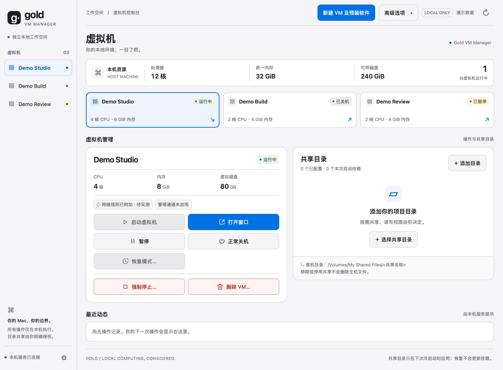
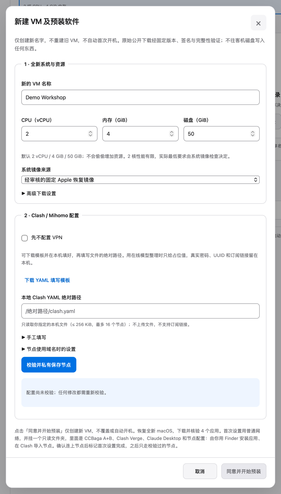
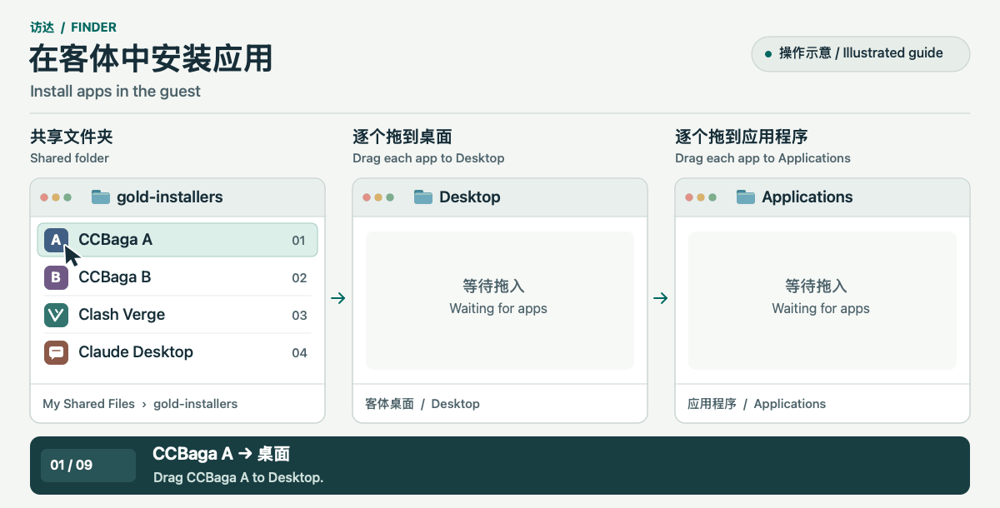

# Gold VM Manager

**[加入 Gold VM 微信交流群](https://weixin.qq.com/g/AQYAAMoC6cPVM_wJbKwTY4TAaGCjDxIoHfW81qVt9QjcPD3nTesOm66syMumSJMb)** · 用微信扫一扫；手机上可长按识别。群邀请有有效期。

<a href="docs/media/wechat-group.png?raw=true"></a>

在 Apple Silicon Mac 上创建独立的 macOS 虚拟机，在客机里使用 Claude Code。首次设置用普通网络；完成设置后，受保护启动只允许客机通过已配置的代理节点出站，不会在代理断开时自动直连。

**[下载 v1.5.1 源码](https://github.com/wbw20000/gold-vm-manager/releases/tag/v1.5.1) · [填写 YAML](#下载并填写-yaml宿主-mac) · [创建窗口逐项点](#创建窗口逐项点) · [看 23 秒安装演示](docs/media/guest-install.gif?raw=true) · [装好后怎么用](#四个应用装好后怎么用客机) · [删除与重建](#删除与重建) · [English](README.en.md)**

> **我的使用记录（本人确认：2026-11-21）**：我现在就在用这台虚拟机跑 Claude Code。用 Pro 的 4 天没有被封；升级 Max 后，截至这次记录，用了 2 天，也没有被封。[我的使用分享 ↗](https://x.com/clarkwang258/status/2123747367639994757)
>
> **升级 Max 起的日历计数：第 <!-- max-days:start -->6<!-- max-days:end --> 天。** 数字每天按新加坡日期更新，不登录或查询我的 Claude 账号；上面那段是我本人确认过的记录。

[](docs/media/manager-overview.png?raw=true)
*实际界面，使用演示数据。点图可放大。*

## 安装管理器（宿主 Mac）

1. **先核对：**Apple Silicon、macOS **26.6.2**（当前验证版本）、Apple Command Line Tools 或 Xcode、系统 Python 3.9+ 和 Ruby/Psych。1.5.1 版新建磁盘可设 **30–1024 GiB**（整数，默认 50）。选 30 GiB、镜像和虚拟盘在同一卷时，复用镜像需 **42 GiB** 可用空间，下载或重新导入则需 **62 GiB**。30 GiB 盘后续的应用与系统更新空间较紧。旧版 1.5.0 要求最低 50 GiB、至少 82 GiB 可用空间。
2. 在 [v1.5.1 发布页](https://github.com/wbw20000/gold-vm-manager/releases/tag/v1.5.1)下载 **Source code (zip)** 并解压。双击 [Install.command](Install.command)，或在源码目录运行 `./Install.command`。完成后，从 `~/Applications` 打开 **Gold VM 管理器**。
3. 这是**本地签名的源码构建**，不是 Apple 公证的成品安装包。安装器不覆盖已有 App，也不自动开机；不要关闭 Gatekeeper。另装新版本见[源码安装指南](SOURCE_INSTALL.md)。

**打开后的第一屏：**在 Finder 的「前往 → 前往文件夹…」输入 `~/Applications`，双击 **Gold VM 管理器**。在「虚拟机控制台」看 **本机资源 → 可用磁盘**。右上角点 **新建 VM 及预装软件**；不要点旁边的「高级选项 → 仅安装 VM」，后者只生成系统暂存盘，不会发布可用的机器。左侧列表用于选择**已有**机器，不是创建入口。

## 下载并填写 YAML（宿主 Mac）

1. **下载。** 在管理器点「新建 VM 及预装软件 → 下载 YAML 填写模板」，或打开 [GitHub 模板](examples/vpn/clash.yaml)，点右上角 **Download raw file（下载原始文件）**。[也可直接打开原始 YAML](https://raw.githubusercontent.com/wbw20000/gold-vm-manager/v1.5.1/examples/vpn/clash.yaml)；如果浏览器显示文本而没下载，按 `⌘S`。把文件存到仓库之外，命名为 `clash.local.yaml`，不要带 `.txt` 后缀。
2. **选协议。** 用纯文本编辑器打开文件，把 `proxies: []` 改为 `proxies:`。找到与你的节点协议一致的一组示例，只删除**那一组**每行开头的 `# `，保留剩下的空格缩进。不要把订阅链接粘进 `server`。
3. **填节点服务商给你的值。** 例如 Trojan TLS/TCP 填好后的**格式**如下。`server` 是节点公网地址，`port` 是整数端口，`password` 是节点密码，`sni` 是服务商指定的 TLS 域名；以下全是占位值，不能直接连接。VLESS、TUIC 等请填模板里对应协议的字段，不要照搬 Trojan 密码栏。

   ```yaml
   proxies:
     - type: trojan
       server: 192.0.2.10
       port: 443
       password: "REPLACE_WITH_TROJAN_PASSWORD"
       sni: vpn.example.com
       network: tcp
       skip-cert-verify: false
   ```

4. **复制路径。** 保存后，在宿主 Finder 选中 `clash.local.yaml`，按 `⌥⌘C`（Option + Command + C）复制完整路径，回到刚才的创建窗口。粘贴的是**路径**，不是文件内容或订阅网址。

## 创建窗口逐项点

**1.5 新功能：再建一台 VM。** 如果本机有保存了构建时节点配置的 v3 VM，先核对「节点来源」中显示的 VM 名称（多台时默认是列表第一台），点 **沿用并校验这组节点**。看到「已沿用」后再确认创建，无需重填 YAML，也不会克隆或改变来源 VM。要换节点，选「填写新的节点」并按下面步骤操作。「继续配置 VPN」也支持这两种来源。

**系统镜像已缓存？** 保留默认镜像选项，不必重新选文件。窗口提示只表示缓存记录匹配；实际创建仍会完整核对 SHA-256。再次选择本地 IPSW 会重新导入一份约 20 GB 的副本。

<details>
<summary>展开创建窗口截图：对照字段和底部提交按钮</summary>

[](docs/media/manager-yaml-form.png?raw=true)

</details>

| 屏幕上看到的区域 | 填什么、点哪里 | 怎样知道可以继续 |
| --- | --- | --- |
| **1 · 全新系统与资源** | 在「新的 VM 名称」填未用过的名字，例如 `demo-mac`；初次可保留 2 核、4 GiB 内存、50 GiB 磁盘。 | 名字不与左侧已有 VM 重复。 |
| **系统镜像来源** | 没有镜像就保留「经审核的固定 Apple 恢复镜像」。已有对应版本的 `.ipsw` 才选「我信任的本机 IPSW 绝对路径」，然后在「可信本地 IPSW 路径」粘贴**镜像**路径。 | 默认方式无需填路径。「高级下载设置」通常留空；这里的代理只影响宿主下载，不是客机节点。 |
| **2 · Clash / Mihomo 配置** | 有 YAML 就不要勾「先不配置 VPN」，保持「手工填写」收起，将刚复制的路径粘到「本地 Clash YAML 绝对路径」。仅当 `server` 是域名时，展开「节点使用域名时的设置」并确认允许解析。 | 点 **校验并私有保存节点**，看到「已私有保存 … 个节点 / … 个端点」。这只是格式校验，不是连通测试。 |
| **窗口底部** | 检查节点数量和归一化提示，点 **同意并开始预装**。 | 主窗口出现「一键预装」任务卡。若提交按钮是灰色，先看前置检查，点「重新检查」；改过节点或校验过期时需重新校验。不要反复点创建。 |
| **主窗口任务卡** | 等待「获取经审核原始材料 → 离线安装系统 → 准备首次设置文件夹与受保护启动 → 发布新 VM」。 | 看到 **未启动 · 待首次设置**，点 **选择新 VM**；也可在左侧点刚起的名字。此时还没开机。 |

**没有 YAML 的分支：**在第 2 区勾「先不配置 VPN」→「同意并开始预装（暂不配置 VPN）」。等任务卡显示「系统已恢复 · 等待配置 VPN」，点 **继续配置 VPN** → 填 YAML 路径 → **校验并私有保存节点** → **同意并继续配置 VPN**。不用重建第二台。

**不用 YAML 的另一种填法：**有单个节点的参数，可展开「手工填写」→ 选择「节点协议」→ 填该协议显示的地址、端口及凭据 → 点「校验并私有保存节点」。收起「手工填写」才回到 YAML 模式，切换后需要重新校验。

**节点配置存在哪里？** 填好的 YAML 不上传 GitHub；宿主私有目录和首次设置的只读共享里含有明文节点凭据，不要分享填好的文件或 VM 磁盘。

## 第一次使用：看状态，做下一步

| 看到什么 | 接下来做什么 |
| --- | --- |
| **宿主：未启动 · 待首次设置** | 选中 VM → **首次设置启动…** → 确认框点 **用普通网络启动首次设置**。卡片显示「首次设置 · 普通网络，未过滤」。若 VM 已运行但看不到客机画面，点 **打开窗口**，不是再点启动。 |
| **客机：macOS 设置助理** | 在虚拟机窗口内选择语言和地区，按屏幕提示完成设置，创建并登录客机本地账户。不同版本、地区的 Apple 页面可能不同；密码只在客机内输入。看到 Finder 桌面才进入下一步。 |
| **客机：Finder → My Shared Files → gold-installers** | 先读「先读我.txt」。把 **CCBaga A、CCBaga B、Clash Verge、Claude Desktop** 从共享文件夹**逐个拖到客机桌面，再逐个拖进「应用程序」**。在 Finder 按 `⇧⌘A` 可打开「应用程序」；不要从共享里直接运行。 |
| **四个应用已在「应用程序」** | 不用把四个都打开。先配置 Clash Verge，再用 CCBaga A 自检，最后使用 Claude；具体操作如下。 |

[](docs/media/guest-install.gif?raw=true)
*[放大循环动图](docs/media/guest-install.gif?raw=true) · [静态步骤图](docs/media/guest-install.png?raw=true)。示意动画，非客机实录。*

## 四个应用装好后怎么用（客机）

1. **先通代理：Clash Verge。** 从「应用程序」打开 Clash Verge →「订阅 → 新建 → 本地 → 选择文件」，选择 **My Shared Files → gold-installers → Clash 节点配置.yaml**。点「保存」，再点选刚建的订阅使它生效。这里选的是管理器为这台客机生成的文件，**不是 GitHub 的空模板**。
2. **开 TUN 并验证流量。** 在 Clash Verge 的「设置」开启「虚拟网卡模式（TUN）」，按客机提示安装服务。用客机浏览器打开网页，同时看 Clash 的「连接」，确认这次请求走了选定的节点，而不是 `DIRECT`。首次设置用普通网络，能打开网页本身不算通过。
3. **再做环境自检：CCBaga A。** 点「浏览器环境」检测；「电脑环境」可对齐时区，按需在客机的「隐私与安全性 → 定位服务」关闭定位，再复查。此流程用 **A**，不需要同时启动 **CCBaga B**。各项变绿后可打开 [IP/DNS 自检页](https://ip.net.coffee/claude/)，参考标准是 **≥70 分且本次未报告 IP/DNS 泄露**。这是第三方诊断，不是 Claude 的账号资格判定，不要在那里输入凭据。
4. **切到日常网络。** 确认代理正常后，在客机苹果菜单点「关机」，等宿主卡片显示「已关机」。在管理器选中同一台 VM →「标记首次设置完成…」→ 确认框点 **标记首次设置完成**。这个标记不可撤销。再点「受保护启动…」→ **同意尝试受保护启动** → 运行后点「打开窗口」。此时安装共享不再挂载，再检查一次 Clash 的连接记录。
5. **最后用 Claude。** 图形聊天就从客机「应用程序」打开 **Claude Desktop**；命令行开发请在**客机内**按 [Claude Code 官方指南](https://code.claude.com/docs/en/quickstart)另行安装，再在客机终端运行 `claude` 并按官方提示登录。装好 Desktop 不等于装好了 Code。

## 日常操作：先在左侧选对 VM

| 我想做什么 | 在宿主管理器里怎么点 |
| --- | --- |
| 关机后扩容（1.5.1） | 先备份、在客机内正常关机，选中受支持的一键预装 VM → **扩容磁盘…** → 填**目标总容量**。例如 30 扩到 40 就填 `40`，不是 `10`。需宿主有至少「增量 + 2 GiB」余量。只扩虚拟设备、不缩盘、不启动 VM。开机后在客机「磁盘工具 → 显示所有设备」分别查看设备容量和 APFS 容器；若容器未自动扩大，先备份，再按分区布局处理，不要点「抹掉」。 |
| 找回客机窗口、关机 | 卡片显示「运行中」时点 **打开窗口**。要关机，先保存客机工作 → **正常关机** → 弹窗再点 **正常关机**；如客机也弹提示，到客机确认。等卡片变成「已关机」才算结束，关闭窗口不等于关机。 |
| 共享一个项目目录 | 「共享目录」区点 **＋ 添加目录** → 填「共享名称」→ **选择目录…** → 选权限（默认只读）→ 保持「启用这个共享目录」→ **保存目录**。选读写还须勾选风险确认。客机下次冷启动后，到 Finder「My Shared Files」找这个共享名称。 |
| 调整或移除共享 | 在对应目录行点 **编辑 / 停用 / 启用**；要彻底移除配置则点 **移除 → 仅移除共享**。不删除宿主原文件。运行中修改要等正常关机再启动才生效。 |
| 暂停、恢复或处理卡死 | 只有支持且本次没有活动共享的运行中 VM 才能点 **暂停**；支持恢复的已暂停 VM 点 **继续运行**。一键预装 VM 不支持暂停。**强制停止… → 强制停止** 仅用于卡死且正常关机无效，会丢未保存工作；**丢弃暂停状态… → 丢弃暂停状态** 会丢失保存的会话。 |
| 忘记客机登录密码 | 仅当旧版兼容 VM 已关机且有 **恢复模式…** 按钮时，点它 → **恢复模式启动**，在客机内按 macOS 提示处理。它不抹盘，也不保证能重置密码；不是「彻底重建」。 |
| 预装任务失败 | 在任务卡看「失败步骤」和「代码」，必要时点右上角 **↻** 刷新。若出现 **归档此失败任务（保留暂存盘） → 归档失败任务**，它只归档任务记录，不删磁盘、不续接、不释放已占空间。 |

## 删除与重建

**删除一台 VM**（[看删除确认框](docs/media/manager-delete-confirm.png?raw=true)）：先备份需要的客机文件并正常关机。左侧点目标名称 → 在「虚拟机管理」点 **删除 VM…** → 核对弹窗标题「永久删除 *目标名称*？」→ 确定才点红色 **永久删除 VM**；点「取消」则不删。运行中不能提交；若删除已暂停的 VM，其暂停状态也会丢失。自 1.4.0 起**不用再输入名字**。等任务显示「已删除」且目标从列表消失。删除不可撤销，不删宿主共享原目录，镜像、缓存和日志可能仍保留。

**彻底重建**（[看旧版兼容 VM 的重建窗口](docs/media/manager-legacy-rebuild.png?raw=true)）：这是**替换旧系统**，不是重启。仅部分旧 macOS VM 有此按钮；通过 1.4.0 一键预装创建的 VM **没有**。对支持的 VM：

1. 先备份，正常关机（或确认可以丢弃暂停状态）。左侧选目标 → **彻底重建…**。
2. 填**新环境**的名称，或点 **使用原名称**；选 CPU、内存、磁盘和镜像来源。若选本地 IPSW，点 **选择镜像…**。这里填名是给新环境命名，不是要求再抄一遍旧名确认。
3. 阅读旧流程的安装材料说明。分别勾选「允许复制宿主当前 Clash 节点配置到新 VM 的只读安装材料…」和「我确认删除选中的旧 VM 全部内容」。只有同意这**两项**才点 **确认删除旧环境并重建**。成功时旧盘和暂停状态都不保留，新环境不继承共享配置；不是新版的 `gold-installers` 流程。

**没有「彻底重建…」但想从头来？** 走右上角 **新建 VM 及预装软件**，用不同名称创建。先验证新机可以使用，再决定是否备份并删除旧机，不必先冒险删盘。

[遇到问题？空间不足 / 设置助理转圈 / Clash 提示临时路径](docs/first-run-troubleshooting.md) · [完整设置指南](ONE_CLICK_PREINSTALL.md) · [隐私与安全](SECURITY.md)
